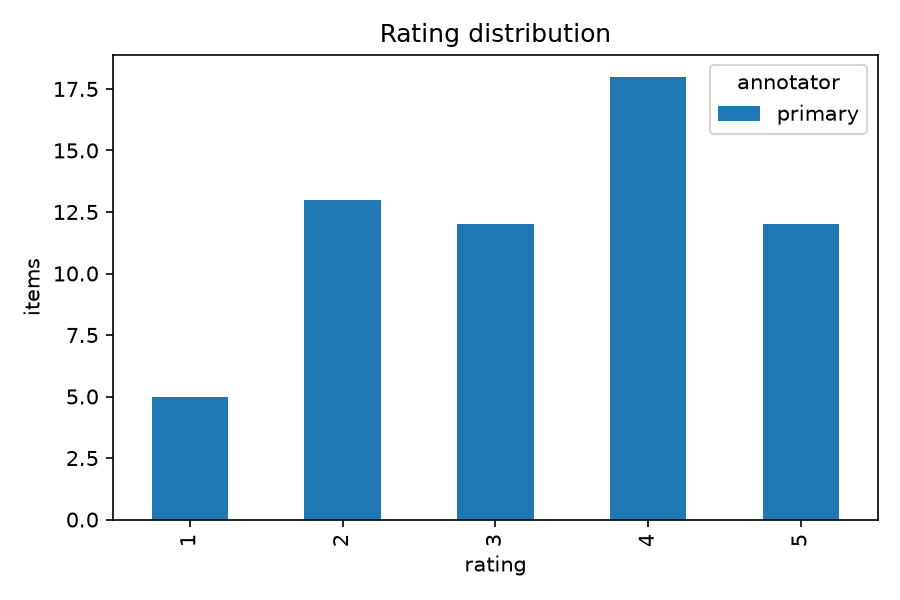
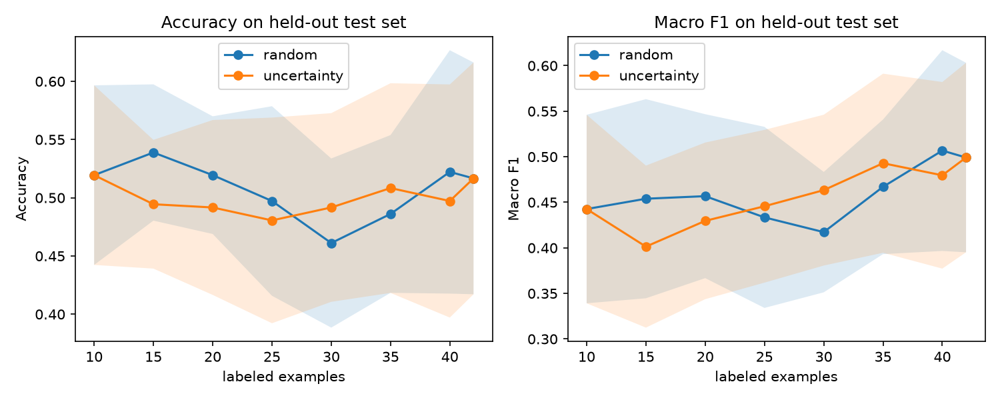

# Hindsight: Annotation and Active Learning Lab

A human-in-the-loop annotation and model-evaluation pipeline on a small subset of Anthropic HH-RLHF (helpful-base, MIT license). Items and annotations live in MongoDB 7. A TF-IDF + logistic regression classifier is trained on human labels, and uncertainty sampling is compared against random sampling.

See [docs/HOW_IT_WORKS.md](docs/HOW_IT_WORKS.md) for a plain-language walkthrough and [DECISIONS.md](DECISIONS.md) for design choices.

## Setup

```bash
git clone <this repo> && cd mongo-annotation-lab
docker compose up --build        # starts MongoDB 7 and loads 300 items
python3 -m venv .venv && source .venv/bin/activate
pip install -r requirements.txt
export PYTHONPATH=src
```

## Usage

```bash
python -m annlab.labeling                          # rate items 1-5 + one-sentence rationale
python -m annlab.labeling --annotator second --second   # second annotator, 40 shared items
python -m annlab.run_experiments --second second   # classifier, active learning, kappa, charts
pytest                                             # tests (DB tests need MongoDB running)
```

Outputs are written to `results/`. `src/annlab/queries.py` holds the aggregation pipelines.

## Results

**Caveat: this is a small sample (60 labels from one annotator), so every number below is indicative only.** With 18 test items, one prediction moves accuracy by about 5.5 points. Nothing here is statistically meaningful, and the second-annotator agreement step has not been run yet, so there is no kappa.

All numbers come from a real run of `python -m annlab.run_experiments` on my labels (`results/report.json`, `results/active_learning.csv`).

### Labels

60 items rated 1-5 by one annotator. The classifier target is binary: rating >= 4 is "helpful" (30 of 60, so the classes are balanced).



### Classifier (TF-IDF + logistic regression)

Single stratified split, 42 train / 18 test.

| Metric | Value |
|---|---|
| Accuracy | 0.444 |
| Macro F1 | 0.416 |
| Majority-class baseline | 0.500 |

The classifier does not beat the majority baseline. The labels are mostly about whether a reply answers the question well, which a bag of words from 42 examples cannot capture.

### Uncertainty sampling vs random sampling

Replayed on the labeled pool, 20 seeded repeats, 10 seed items, batches of 5, same held-out split for both strategies. Mean over repeats (std in `results/active_learning.csv`):

| Labeled | Random acc | Uncertainty acc | Random macro F1 | Uncertainty macro F1 |
|---|---|---|---|---|
| 10 | 0.519 | 0.519 | 0.443 | 0.443 |
| 20 | 0.519 | 0.492 | 0.457 | 0.430 |
| 30 | 0.461 | 0.492 | 0.417 | 0.463 |
| 40 | 0.522 | 0.497 | 0.507 | 0.480 |
| 42 (all) | 0.517 | 0.517 | 0.499 | 0.499 |



Both curves hover around 0.5, which is chance for balanced classes, and the standard deviations (about 0.05 to 0.10) are larger than any gap between the strategies. **This experiment does not show that uncertainty sampling helps or hurts.** The two strategies end at the same point because by 42 labels both have used the whole pool. A fair test needs more labels and a model that beats the baseline first.
